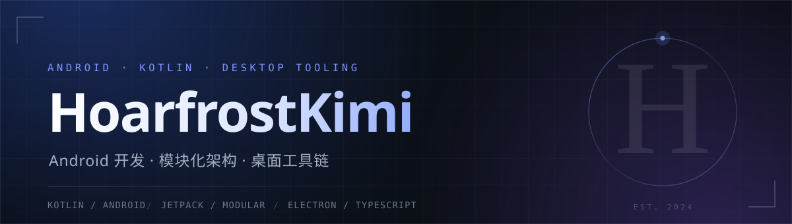
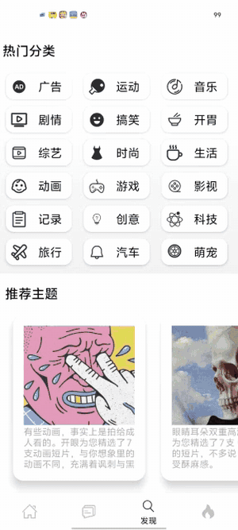

  

  
  
  
  

---

### 关于

写代码的动机通常很朴素：**有些事太重复了，重复到值得写个工具**；也有些 App 好看到让人想拆开重写一遍。

主战场是 **Kotlin / Android**：MVVM、Paging 3、协程与 Flow、自绘组件。桌面上的活交给 **TypeScript + Electron**，音视频交给 **FFmpeg**。

打得最完整的是 [开眼 OpenEyes](https://github.com/generalio/OpenEyes) —— 两个人从零拆模块写完的短视频客户端，发现与排行两个模块归我。

---

### 主项目 · 开眼 OpenEyes

> 短视频 Android 客户端，按业务拆成 `app` / `lib_base` / `lib_net` / `module_home` / `module_discover` / `module_rankings` 六个模块，接口层与 UI 层分开，各模块独立编译。
> 我负责 **发现** 和 **排行**：从 UI 标注、分页加载到播放器，都是自己写下来的。

  
  &nbsp;&nbsp;&nbsp;
  

发现 · 主题列表的共享元素转场　　·　　排行 · 首项升级为视频卡并自动播放

- **发现** ｜ 分类网格 + 主题推荐。分类页用 **RV 嵌套 RV** 换掉 ScrollView —— 不然上滑时没法跟底部导航栏联动；分类详情用协调者布局，折叠后分类名收进 Toolbar；主题列表做共享元素转场，并加 50ms 延迟避开首帧未加载导致的动画畸变
- **排行** ｜ ViewPager2 双页切换，重写 ConstraintLayout 解决与外层滚动的滑动冲突；切到排行页时首个 item 自动升级成视频卡并用 ExoPlayer 播放，滑出屏幕立即降级、暂停并释放播放器
- **数据** ｜ **Paging 3 + Flow** 做无限加载，`LoadStateAdapter` 统一 loading / retry / 到底三种状态；网络层以 Retrofit + Flow + StateFlow 为主，部分老页面沿用 RxJava + LiveData
- **踩过的坑** ｜ 列表复用导致播放器错位、转场首帧畸变、ViewPager2 与内层 RV 争抢滑动 —— 全都是自己定位、自己改的

`Kotlin` `Jetpack` `MVVM` `Paging 3` `Coroutines` `Flow` `Retrofit` `RxJava` `ExoPlayer` `ViewPager2`

仓库：[generalio/OpenEyes](https://github.com/generalio/OpenEyes)

---

### 其他作品

| 项目 | 解决什么问题 | 技术栈 |
| :-- | :-- | :-- |
| **[Video-Merger](https://github.com/HoarfrostKimi/Video-Merger)** | 录播 FLV 分段自动识别场次、无损合并成 MP4；带定时合并、B 站自动投稿、局域网手机控制面板 | `Electron` `React` `TypeScript` `FFmpeg` |
| **[PredictCoin](https://github.com/HoarfrostKimi/PredictCoin)** | 预测币仓位计算器。双边奖池下赔率就是池比例，期望对数增长率求导得 `f* = (q − p) / (1 − p)`；六层收缩后给建议区间，没优势就直接不下注 | `Kotlin` `Android` `Canvas 自绘` |
| **[TODO](https://github.com/HoarfrostKimi/TODO)** | 待办 + 番茄钟。Room 多用户隔离、拖动排序、侧滑删除、自定义时长 | `Kotlin` `MVVM` `Room` `RxJava` |
| **[RedRockHomeWork](https://github.com/HoarfrostKimi/RedRockHomeWork)** | 安卓登录系统（早期练习） | `Java` `Android` |
| **[GreetingCard](https://github.com/HoarfrostKimi/GreetingCard)** · **[Zhihu](https://github.com/HoarfrostKimi/Zhihu)** | 贺卡、知乎客户端 —— 练手用 | `Kotlin` |

### 发布

| 应用 | 平台 | 安装包 |
| :-- | :-- | :-- |
| **Video-Merger** `v1.0.0` | Windows 10 / 11 | [video-merger-1.0.0-setup.exe](https://github.com/HoarfrostKimi/Video-Merger/releases/download/v1.0.0/video-merger-1.0.0-setup.exe) · 199 MB，内置 Chromium + FFmpeg |
| **PredictCoin** `v1.0` | Android 7.0+ | [PredictCoin-1.0.apk](https://github.com/HoarfrostKimi/PredictCoin/releases/download/v1.0/PredictCoin-1.0.apk) · 7.8 MB |

---

### 技术栈

**语言**

**客户端**

**桌面与工具**

---

### 工程习惯

- **提交前跑测试和类型检查**，卡住就修，不用 `--no-verify` 绕过去
- **一次提交只装一件事**，无关改动单独留着，方便回退
- **依赖能不加就不加**，能用标准库就不引框架
- **能本地算的不要联网**，能不申请权限就不申请
- **界面能自己画就自己画** —— 预测币的卡片、滑块、收益曲线都是 View + Canvas 手写的

---

### 在做

- 给 PredictCoin 补引擎单测：边界盘口、连败降档、约束取最小
- Video-Merger 的投稿链路跟着 B 站改版走：双比例封面、创作声明必填、后台标签页节流
- 系统补 Android 基础：View 的测量与绘制、启动性能、Jetpack 组件到底在做什么

主页自己维护 · 最近更新 2026.11
